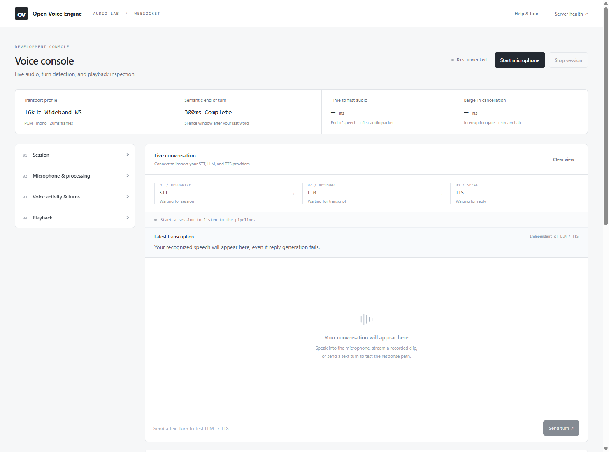

# Open Voice Engine

A provider-agnostic runtime for bidirectional voice over WebSockets, with a browser console for live audio tuning, interruption testing, and latency profiling.

**Python 3.11+ · Pure WebSockets · Zero-build browser console · Key-free mock defaults**

[Quick start](#quick-start) · [Browser console](#browser-console) · [SIP call lab](#sip-call-lab) · [Providers](#providers) · [Architecture](#architecture) · [Benchmarks](#benchmarks) · [Documentation](#documentation)

## Quick start

Run from the repository directory with Python 3.11 or newer. The default configuration uses mocks for every provider; no API keys, model downloads, or frontend build are required.

<details open>
<summary><strong>Windows PowerShell</strong></summary>

```powershell
git clone https://github.com/techieworld2/open-voice-agent.git
cd open-voice-agent
python -m venv .venv
.\.venv\Scripts\python.exe -m pip install --upgrade pip
.\.venv\Scripts\python.exe -m pip install -e ".[dev]"
Copy-Item .env.example .env
.\.venv\Scripts\python.exe -m uvicorn voice_engine.server.app:app --host 127.0.0.1 --port 8000
```

</details>

<details>
<summary><strong>Linux / macOS</strong></summary>

```bash
git clone https://github.com/techieworld2/open-voice-agent.git
cd open-voice-agent
python3 -m venv .venv
source .venv/bin/activate
python -m pip install --upgrade pip
python -m pip install -e ".[dev]"
cp .env.example .env
voice-engine dev --host 127.0.0.1 --port 8000
```

</details>

Open **[localhost:8000](http://localhost:8000)** or **[127.0.0.1:8000](http://127.0.0.1:8000)**, allow microphone access, and choose **Start microphone**. The guided tour explains the controls; **Skip tour** and **Esc** dismiss it, and **Help & tour** replays it.

Mock STT returns deterministic text and mock TTS plays synthetic tones. Select real providers for natural conversation.

Configure providers in `.env` and restart the server after provider changes. Browser audio and VAD controls apply live within the connected session.

## Browser console



The four settings panels start collapsed. Technical controls have **?** explanations on hover, keyboard focus, or tap.

| Goal | Where to start |
|---|---|
| Try local STT without an LLM | **Session → Transcription only**. Speech remains visible even if reply generation is unavailable. |
| Compare microphone processing live | **Listen & tune live → Listen to my input**, with **Processed input** selected. Use headphones and toggle controls in **Microphone & processing**. |
| Hear VAD decisions | Select **VAD speech gate** as the monitor source, then change thresholds or durations while speaking. |
| Tune turn taking | **Voice activity & turns**. The live VAD badge and server revision confirm what is active. |
| Reproduce an audio test | Choose an audio file as the session source, or save a five-second input capture for replay. |
| Inspect interruptions | Watch the spoken prefix and red strikethrough text in the conversation panel. |

**VAD changes detection and timing; it does not change voice timbre.** The gate preview makes detection audible. A saved capture is a fixed snapshot, so use the live monitor to compare later changes. Switching between the 16kHz and 8kHz transport profiles currently requires reconnecting the session.

See the **[audio tuning guide](docs/audio-guide.md)** for VAD definitions, presets, and playback controls.

## Audio profiles

| Profile | Rate | Codec | Samples / frame | Bytes / frame | Complete / trailing silence |
|---|---:|---|---:|---:|---:|
| Wideband | 16,000Hz | PCM s16le | 320 | 640 | 300 / 950ms |
| Phone simulation | 8,000Hz | PCM s16le | 160 | 320 | 350 / 1100ms |
| Phone simulation | 8,000Hz | G.711 μ-law | 160 | 160 | 350 / 1100ms |

Every frame represents **20ms**. Phone simulation applies a **300–3400Hz bandpass** on microphone and speaker paths. STT receives 16kHz mono PCM; telephony input retains its narrowband detail after upsampling.

Connect to `/ws/voice?mode=wideband` or `/ws/voice?mode=telephony&codec=mulaw`. Omitted parameters use `.env` defaults. These browser profiles simulate phone acoustics over WebSockets. The optional SIP call lab below adds a real SIP/RTP leg without WebRTC.

PCM needs no codec extra. Python 3.11/3.12 includes `audioop`; for μ-law on Python 3.13+, install `python -m pip install -e ".[mulaw]"`.

## SIP call lab

Use a softphone such as Linphone to dial your agent through **FreeSWITCH running natively on Windows**. A separate **[SIP dashboard](http://localhost:8000/call-lab)** shares the console theme and displays live transcripts, VAD controls, interruptions, and timings. A local Python bridge adds optional delay, jitter, and packet loss to the FreeSWITCH-to-engine RTP leg.

The dashboard can also play the caller audio received by STT, preview VAD gating, and capture/replay five seconds. Configure real providers in the lab's private `lab.env`; newly generated labs use mocks. Phone microphone processing remains in Linphone or the calling device.

```bash
python -m tools.setup_freeswitch_lab --host YOUR_LAN_IPV4
python -m tools.run_freeswitch_lab --freeswitch-dir "C:\Program Files\FreeSWITCH"
```

Requires a trusted native Windows FreeSWITCH installation with its standard SIP and event-socket modules. No Docker, Ubuntu, paid streaming module, or C++ gateway build is required for this adapter. Setup prints a private SIP password and dashboard token. Register softphone account **1001** against your computer's LAN IP and dial **7000**. Defaults use mocks and require no public phone number or paid API keys. The original browser console runs independently of FreeSWITCH.

See the **[call lab guide](docs/call-lab.md)** for account setup, network presets, real providers, the `python -m tools.sip_probe` smoke call, and measurement boundaries. This tests local VoIP behavior; cellular and carrier behavior still need real-network validation.

## Providers

The [provider registry](src/voice_engine/providers/registry.py) keeps STT, LLM, and TTS interchangeable through their existing interfaces.

| Role | Provider setting | Optional install | Requirements |
|---|---|---|---|
| All | `mock` | Base installation | No model files or API keys |
| STT | `faster_whisper` | `.[whisper]` | Local Whisper model; defaults to the smaller multilingual `base` model |
| LLM / TTS | `gemini` | `.[gemini]` | `GEMINI_API_KEY` or `GOOGLE_API_KEY`, and access to the configured model |
| LLM | `openai_completions` | `.[openai_completions]` | Compatible `/v1/completions` server, such as vLLM or Ollama |
| TTS | `kokoro` | `.[kokoro]` | Local Kokoro dependencies and models |
| TTS | `deepgram` | `.[deepgram]` | `DEEPGRAM_API_KEY` |

Choose providers with `VOICE_ENGINE_STT`, `VOICE_ENGINE_LLM`, and `VOICE_ENGINE_TTS` in `.env`. All three default to `mock` in [.env.example](.env.example).

For local Whisper plus Gemini and Deepgram, install their extras:

```bash
python -m pip install -e ".[whisper,gemini,deepgram]"
```

Set `VOICE_ENGINE_STT=faster_whisper`, `VOICE_ENGINE_LLM=gemini`, and `VOICE_ENGINE_TTS=deepgram`, plus your keys and available model names. Use **Transcription only** to test local recognition without LLM/TTS requests.

Whisper defaults to `base` and downloads on first use unless cached. `VOICE_ENGINE_WHISPER_MODEL` also accepts a local model directory. Faster-whisper transcribes after the utterance ends rather than emitting word-by-word partials.

For vLLM/Ollama, configure `VOICE_ENGINE_LLM_URL` and `VOICE_ENGINE_LLM_MODEL` for the server's compatible completion endpoint. Custom providers can follow [examples/custom_provider.py](examples/custom_provider.py).

## Architecture

```text
 Browser microphone                                    Browser speaker
        |                                                     ^
 Browser DSP + phone bandpass                         Phone bandpass
        |                                                     ^
 Capture AudioWorklet                                 Playback AudioWorklet
 resample + 20ms frames                               queue + sample ACKs
        |                                                     ^
        +================== WEBSOCKET ========================+
                            |                       ^
                     decode + resample              |
                            |                       |
                    Energy VAD + STT                |
                            |                       |
                     semantic EoT                   |
                            |                       |
                       LLM registry                 |
                            |                       |
                      phrase chunker                |
                            |                       |
                       TTS registry ----> resample + frame + pace

 Confirmed barge-in --> cancel generation --> barge_in_clear --> flush player
 Playback watermark --> truncate assistant history --> context.sync

 Benchmark API / CLI --> concurrent WebSocket callers --> latency percentiles

 Optional SIP lab:
 Softphone -- SIP + RTP --> FreeSWITCH -- loopback SIP/RTP --> same voice pipeline
                                             |                      |
                                       RTP impairments      /call-lab dashboard
```

Semantic endings adjust silence windows; short bursts and passive backchannels are filtered before interruption. See [turn detection and interruption details](docs/audio-guide.md#turn-detection-and-interruptions) for the heuristics and timing.

**History precision depends on TTS alignment.** Aligned providers can retain completed words; providers without timestamps retain completed phrases conservatively. Mock TTS supplies word boundaries. Render acknowledgements do not measure physical speaker latency.

## Benchmarks

With the server running, use the browser's **Run 30-Call Concurrency Benchmark** button or the dependency-free CLI:

```bash
python -m benchmarks.stress_tester --concurrency 30 --mode telephony
python -m benchmarks.stress_tester --concurrency 30 --mode wideband --json
```

API: `GET /api/benchmark?concurrency=30&mode=telephony`. Supply `Authorization: Bearer ...` when authentication is enabled.

Each caller sends paced voiced tones, completes a response, and interrupts a second response. The harness tests transport, VAD, and mock recognition rather than real STT accuracy. Failed calls are reported separately and excluded from percentiles.

Example table — **illustrative values, not measured results or a performance guarantee**:

| Metric (ms) | P50 | P95 | P99 | Max |
|---|---:|---:|---:|---:|
| Time to first audio | 550.0 | 565.0 | 570.0 | 575.0 |
| Complete-turn latency | 4150.0 | 4250.0 | 4290.0 | 4300.0 |
| Barge-in cancellation | 65.0 | 145.0 | 150.0 | 155.0 |

Timings include transport and exclude speaker hardware latency. See the [protocol guide](docs/protocol.md#metrics-and-http-endpoints) for measurement boundaries.

## Development

Core tests use mocks and require no paid API keys. Optional provider tests may skip until their SDK extras are installed. Node checks need no npm install or frontend build.

```bash
python -m pytest -q
node --test tests/worklet.test.cjs tests/console.test.cjs
```

Docker uses the same mock defaults:

```bash
docker compose up --build
```

Compose loads `.env` when present; the optional `env_file` configuration requires Compose 2.24+. Install provider extras in a custom image when selecting real providers. Local keys, models, and virtual environments are excluded from the build context.

## Documentation

- [Audio tuning guide](docs/audio-guide.md) — VAD definitions, live listening, presets, semantic turns, and interruption precision.
- [WebSocket protocol](docs/protocol.md) — connection profiles, controls, audio framing, events, and metric definitions.
- [SIP call lab](docs/call-lab.md) — native FreeSWITCH setup, softphone extensions, RTP impairment, and call validation.
- [Environment reference](.env.example) — provider models, keys, endpoints, and server defaults.
- [Custom provider example](examples/custom_provider.py) · [Contributing](CONTRIBUTING.md)

Released under the [MIT license](LICENSE).
